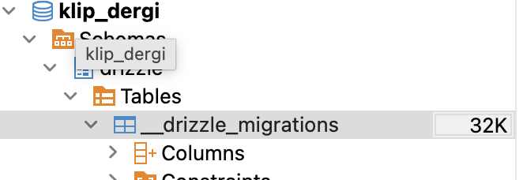
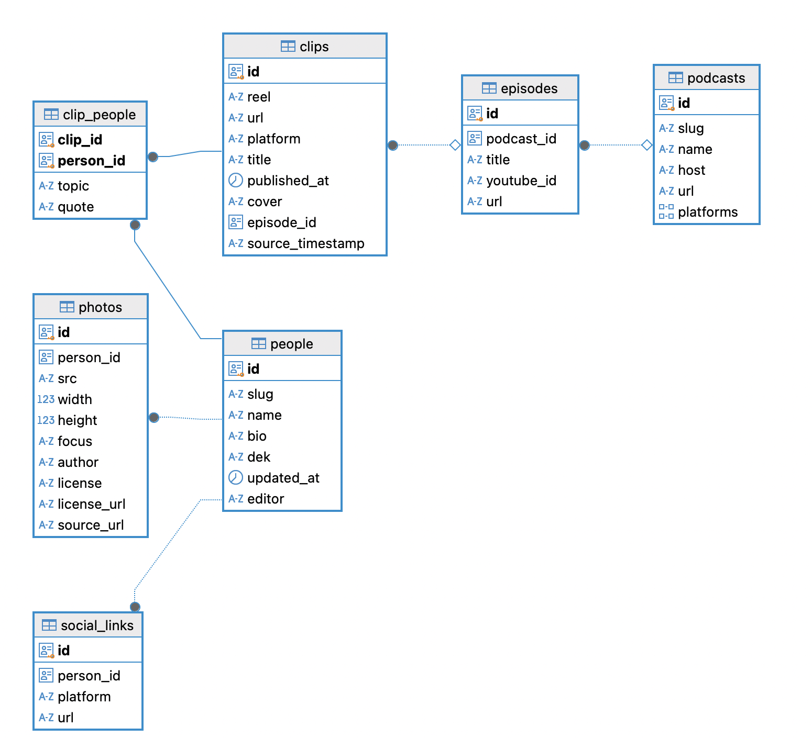
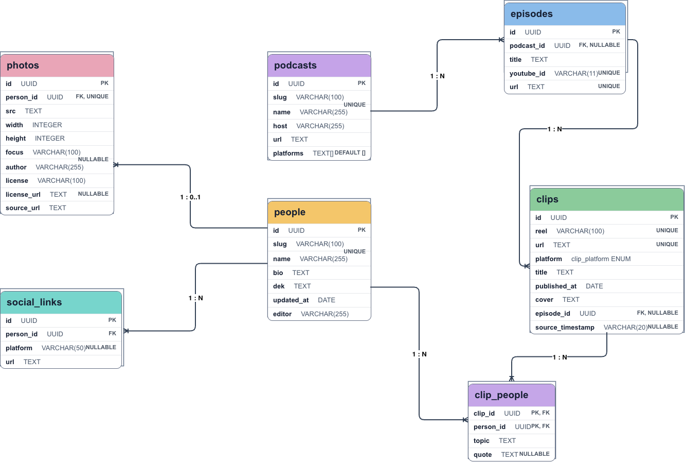

## Database Migrations

A migration records database schema changes and applies them consistently across environments.

Database schema is managed using Drizzle ORM and Drizzle Kit.

### Migration Commands

Generate a migration:

```bash
npx drizzle-kit generate
```

Apply migrations to PostgreSQL:

```bash
npx drizzle-kit migrate
```

### Migration Structure

```text
drizzle/
├── meta/
│   ├── _journal.json
│   └── 0000_snapshot.json
└── 0000_skinny_umar.sql
```

Drizzle tracks applied migrations in the `__drizzle_migrations` table.

### Database Structure

The following screenshots show the migration history and database tables in DBeaver.





The complete database schema, including tables, columns, primary keys, foreign keys and relationships, is documented in the Draw.io ER diagram.


